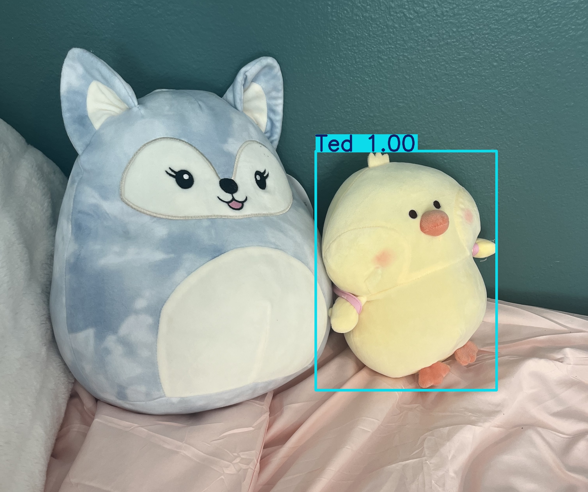

# Bobby-Ted Detector

A YOLO11 object-detection project for identifying my stuffed animals, Bobby and Ted.



## How I built it

1. **Creaated the dataset by capturing images** I took pictures of Bobby and Ted in different positions and places
2. **Labeled the dataset.** I used [LabelImg](https://github.com/HumanSignal/labelImg) to draw a box around each stuffed animal and mark it as `Bobby` or `Ted`.
3. **Exported YOLO labels.** LabelImg saves one `.txt` file per image, with one line per box:

   ```text
   class_id center_x center_y width height
   ```
  
  For example:

   ```text
   0 0.254960 0.435268 0.210979 0.200893
   1 0.664187 0.447917 0.407077 0.316964
   ```

   That's one Bobby (class 0) and one Ted (class 1) in the same photo.

4. **Split the data.** 60 images for training and 8 for validation. Across the labels there are 51 Bobby boxes and 49 Ted boxes, so the classes are pretty balanced.
5. **Fine-tuned YOLO11.** I started from the pretrained `yolo11n.pt` (the smallest YOLO11 model) and trained it on my two classes with [Ultralytics](https://docs.ultralytics.com/).

## Results

My final run (`train5`) trained for 50 epochs at 640x640 with a batch size of 16. On the validation set it got:

| Metric | Score |
|---|---|
| mAP50 | ~0.995 |
| mAP50-95 | ~0.917 |

Due to a limited number of validation images, the scores may be inflated, a larger dataset is needed to make absolute conclusions.

## Try it yourself

Set up a virtual environment and install Ultralytics:

```bash
python3 -m venv .venv
source .venv/bin/activate
python -m pip install --upgrade pip ultralytics
```

Then run the trained model on a photo:

```bash
python3 - <<'PY'
from ultralytics import YOLO

model = YOLO("Emily/runs/detect/train5/weights/best.pt")
results = model.predict(source="Emily/IMG_0942.jpg", save=True)
print(results)
PY
```

The annotated image gets saved under `runs/detect/predict/`.

`best.pt` is the checkpoint with the best validation score, and `last.pt` is the one from the final epoch. Both are in `Emily/runs/detect/train5/weights/`.

## Training it again

The dataset config is [`Emily/stuffed_animals/config.yaml`](Emily/stuffed_animals/config.yaml) and it defines the two classes:

```yaml
names:
  0: Bobby
  1: Ted
```

The current paths are local and won't work on another machine as is. Change them to the real location of the dataset before running anything, then:

```bash
python3 Emily/stuffed_animals/train.py
```

## Future Improvements 
- Add a lot more photos to increase the dataset, especially with different lighting, angles and backgrounds
- Make the validation set bigger so the scores mean more
